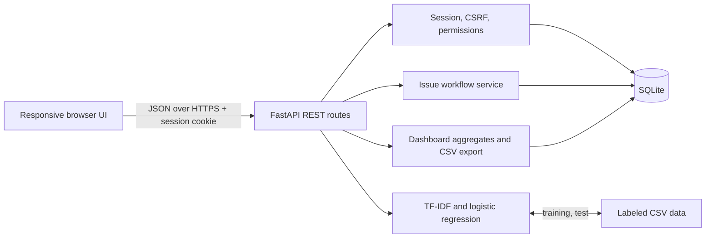
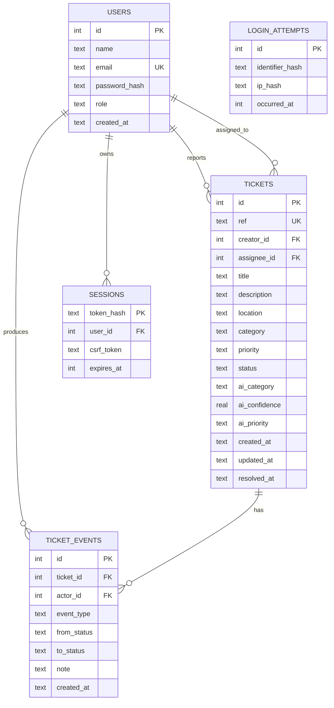

# Architecture, database and business logic

## Design choice

A modular FastAPI application serves the same-origin responsive HTML/CSS/vanilla JavaScript client and exposes a documented REST API. SQLite stores relational data; scikit-learn trains a small text categorizer deterministically from CSV at startup. This keeps the demo inexpensive and understandable while providing a nontrivial full stack. No third-party inference API is needed.

## Component diagram

### Main files

- `app/main.py`: route handlers, owner/staff authorization, transitions and aggregation.
- `app/schemas.py`: Pydantic request contracts (`extra='forbid'` and validation bounds).
- `app/database.py`: schema, SQLite foreign keys/indexes and transactional connection helper.
- `app/auth.py`: password hashing, opaque session lifecycle, CSRF and login throttling.
- `app/seed.py`: 24 optional fictional tickets, two students and staff/admin accounts.
- `app/ml.py`: text classifier, model probabilities, holdout evaluation and priority rules.
- `static/`: dependency-free browser UI.

## ER diagram

## Business rules

1. Every authenticated user may create a report. The database persists only their manually chosen category and priority as authoritative, alongside separately stored AI recommendations for comparison/audit.
2. Students can retrieve and comment only on their own tickets. Staff/admin can see all and manage assignments and status transitions. Non-owners receive 404 (not a revealing 403) for ticket detail and comment endpoints.
3. A report starts `Open`. Legal transitions are `Open -> In Progress -> Resolved -> Reopened -> In Progress`. Illegal jumps return HTTP 409. Only staff/admin can transition.
4. Only users whose role is staff/admin can be assigned to a ticket. Both staff and admin can assign; there is no privileged student escalation route.
5. Every created ticket, assignment, comment, or transition emits a `ticket_events` row in the same transaction for inspectable history.
6. Dashboard aggregates query real rows; all student aggregations use a server-side creator ownership predicate. Filtered results use server-side pagination (1–50 per page).
7. Export generates a server-side staff-only CSV and escapes spreadsheet formula prefixes.
8. DB constraints, foreign keys, indexes, parameterized statements, explicit write transactions and busy timeouts reduce data integrity issues.

## API contract, errors and loading

FastAPI provides `/docs` (interactive OpenAPI). Response codes are meaningful: `201` created, `401` unauthenticated, `403` forbidden/CSRF, `404` unseen records, `409` duplicate or illegal workflow transition, `415` unsupported content type, `422` validation error, `429` too many failed logins. The frontend displays explicit success/error/loading and empty states and confirms submission via report reference.

## Operational decisions and alternatives

- **SQLite:** ideal for demonstration and small single-instance deployment; for multi-instance production, migrate to managed Postgres (SQL code requires adaptation) and configure managed migration tooling, backups, observability and centralized session storage.
- **Training on startup:** 380 labeled texts train quickly and reproducibly; larger datasets should use a versioned offline training pipeline and audited model artifact.
- **No external calls:** avoids API credentials and rate caps; cannot classify beyond the self-authored corpus.
- **UI:** no Node install step, fast static delivery and fewer moving pieces; manual DOM rendering requires care and would benefit from formal end-to-end browser tests before production.

## Testing

`python -m pytest -q` executes 21 tests covering role scopes, login, registration, CSRF, JSON content type, origin checks, validation, CRUD workflow, auditing, assignment, CSV permissions, and model reports. `python scripts/evaluate_model.py` reproduces model metrics. CI runs these checks for each push.
